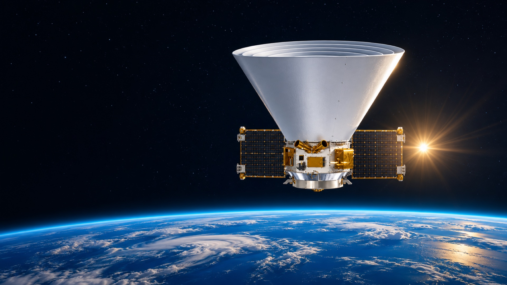
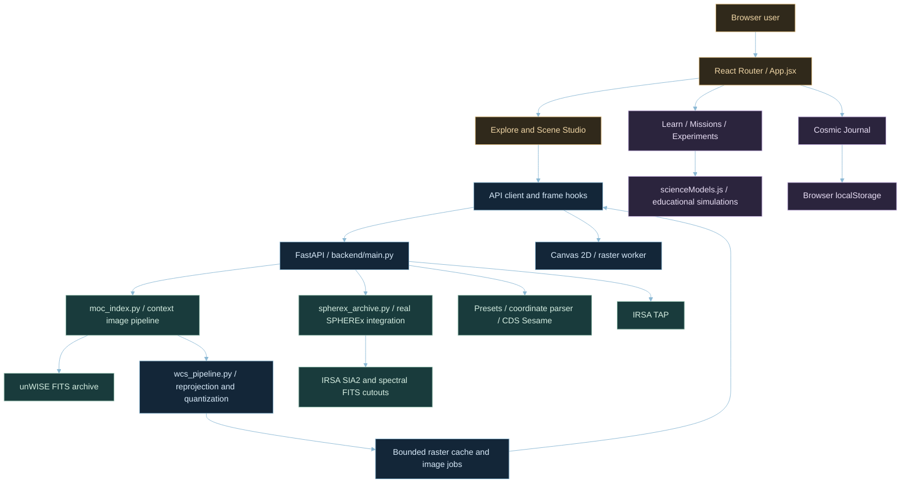
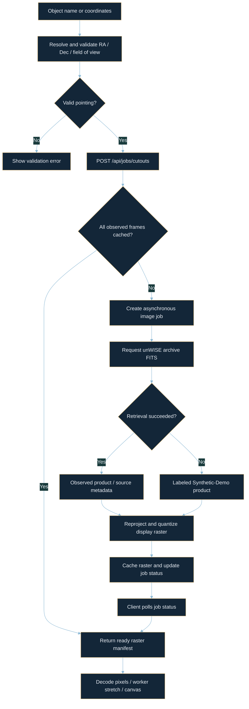
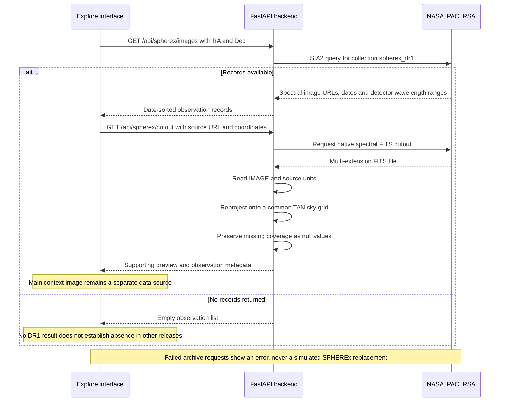
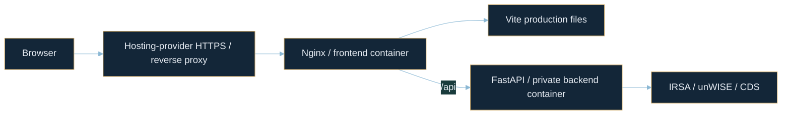

<div align="center">

# ✦ SPHEREx Sky Explorer

**Explore the infrared sky. Follow a question. Keep your discoveries.**

[](https://github.com/Kaashviw3spaces/NASA-spherex-sky-explorer/actions/workflows/checks.yml)




<sub>AI-assisted mission illustration based on NASA/JPL-Caltech reference artwork · not telescope data · <a href="frontend/public/images/CREDITS.md">Image credits</a></sub>

**[Get started](#run-locally) · [Architecture](#architecture) · [Data sources](#understand-the-data-first) · [Deploy](#production-deployment) · [Tests](#tests-and-verification)**


</div>

---

A public-facing astronomy exploration and learning platform built with **React, Vite, and FastAPI**. Explore infrared sky images, inspect observation metadata, compare available frames, experiment with light, and keep a personal discovery journal.

This is an independent educational project inspired by NASA’s SPHEREx mission. It is not an official NASA application and does not claim verified planet discoveries or chemical detections.

<a id="what-you-can-do"></a>

## 🔭 What you can do

| Experience | Route | What it provides |
| --- | --- | --- |
| Home | `/` | Scroll-scrubbed mission introduction, target search, and discovery links |
| Explore | `/explorer` | Context imagery, SPHEREx observation dates and metadata, comparison modes, and a labeled teaching spectrum |
| Field guide | `/learn` | Progressive explanations, a traveling-wave lab, simulated spectrum, image-processing loupe, and glossary |
| Missions | `/missions` | Five guided investigations with objectives, checks, reflections, and local progress |
| Experiments | `/experiments` | Interactive redshift, dust transmission, and spectrum models |
| Journal | `/library` | Saved skies, notes, reflections, mission history, and local backup tools |
| Scene Studio | `/scene` | Canvas-first image playback, comparison, recording, fullscreen viewing, and saved settings |
| Targets | `/targets` | Searchable coordinate presets with educational context |
| Architecture | `/architecture` | Technical and data-source explanations |
| Legacy explorer | `/legacy-explorer` | Original context-image and teaching-spectrum tools |

Old `/spherex` links redirect to `/explorer`, retaining their query parameters. The separate observations page has been retired.

<a id="understand-the-data-first"></a>

## 🛰️ Understand the data first

The app combines several **distinct** data paths. Observations, illustrations, and educational models are not interchangeable.

| Data or visual | Source and treatment | Important limit |
| --- | --- | --- |
| Explore and Scene Studio images | unWISE FITS retrieval, WCS reprojection, display stretch, and color mapping | Context imagery is not a SPHEREx exposure. Dates and units may be missing in the source. |
| Fallback image frames | Explicit `Synthetic-Demo` generation after archive retrieval fails | Simulated, arbitrary signal; no telescope observation date |
| SPHEREx dates and metadata | NASA/IPAC IRSA SIA2 discovery of DR1 spectral images at the requested coordinates | Separate observations, not the context image’s capture dates |
| SPHEREx preview API | Real IRSA FITS cutouts on a common 128×128 TAN sky grid | Bilinear interpolation is not integrated-flux conserving; previews are enlarged for display. |
| Main Explore spectrum | Shared demo-spectrum pipeline and `SpectrumChart.jsx` | Generated teaching curve, not an extracted spectrum or chemical-composition measurement |
| Experimental spectral-sample API | Nearest native SPHEREx pixel across up to 12 selected exposures; wavelength lookup and variance | Exploratory, incomplete sampling; not currently the main Explore graph |
| Catalog queries | IRSA TAP; default table `allwise_p3as_psd` | Failed queries return unavailable results, not invented sources. |
| Sky map | Coordinate selection with illustrative shading | Not a verified SPHEREx coverage map |
| Mission/editorial imagery | Credited NASA/Webb material and an AI-assisted SPHEREx homepage illustration | Artwork and educational illustrations are not telescope measurements. |

SPHEREx covers approximately **0.75–5 µm in 102 spectral bands**; that does not mean every selected position has complete coverage. Molecular markers on teaching charts are reference positions, not detections. Comparing images requires attention to observing dates, wavelength response, resolution, calibration, alignment, noise, and quality flags.

The experimental extraction accepts pixels with only the informational `SOURCE` and/or `FULLSAMPLE` flags, rejects other flags, and reports `sqrt(VARIANCE)` as statistical uncertainty. It does not perform PSF/aperture photometry, background subtraction, variability correction, a continuum fit, or abundance estimation. Its WCS-WAVE wavelengths are intended for visualization. Missing samples remain gaps.

**Challenge scope:** the project supports public exploration and educational time comparison. It is not yet a validated SPHEREx motion-search or Planet X detection pipeline. The main observation viewport currently uses context imagery, while real SPHEREx products are available through the backend integration.

References: [SPHEREx at NASA](https://science.nasa.gov/mission/spherex/), [IRSA SPHEREx archive](https://irsa.ipac.caltech.edu/Missions/spherex.html), [IRSA data access](https://caltech-ipac.github.io/spherex-archive-documentation/spherex-data-access/), [IRSA data products](https://caltech-ipac.github.io/spherex-archive-documentation/spherex-data-products/), [unWISE](https://unwise.me/).

<a id="architecture"></a>

## 🧭 Architecture



### Context-image request flow

`useCutoutFrames.js` associates frames with the exact request identity, so changing coordinates cannot expose a previous target’s result. The client publishes frames progressively and caches complete results.



Archive release names (`allwise`, `neo2`, `neo5`, `neo7`) are not precise observing dates. Legacy band indices 0–50 select W1, and 51–102 select W2; these are not 103 observed bands. Failed/incomplete jobs are reported, and users can retry. Downloaded FITS from `/api/export/fits` are resampled/quantized **display products**, not the original archive files.

### Real SPHEREx integration

Explore uses two separate paths: **context imagery for its main canvas**, and **real SPHEREx DR1 observations for dates, metadata, and supporting preview products**. The main spectrum remains a labeled teaching model. The sequence below describes the SPHEREx path only.



Implementation: [`useSpherexFrames.js`](frontend/src/hooks/useSpherexFrames.js) → [`main.py`](backend/main.py) → [`spherex_archive.py`](backend/spherex_archive.py). [`DataNotice.jsx`](frontend/src/components/DataNotice.jsx) displays the selected SPHEREx metadata separately from the context-image source.

- **Discovery:** DR1 only, up to 300 date-sorted records. The hook selects up to three exposures with the same detector-wide wavelength range. This does not guarantee matching wavelengths at every pixel.
- **Preview:** 128×128 common TAN grid with bilinear interpolation, enlarged for display. Source FITS retains the original quality, variance, and spectral-WCS extensions. These are not propagated into preview uncertainties.
- **Caching:** discovery results for 10 minutes and previews for one hour, with bounded in-process caches and duplicate-request coalescing. The frontend retains a bounded recent-preview cache and loads selected exposures concurrently.
- **Errors:** cutout downloads are limited to 32 MB. Missing coverage stays empty and archive failures remain errors. First-time retrieval still depends on IRSA availability and download speed.
- **Experimental extraction:** `/api/spherex/spectral-samples` is a separate exploratory extraction endpoint, not the source of the main Explore spectrum and not a chemical-identification pipeline.

<a id="learning-design"></a>

## 🧪 Learning design


- **Progressive explanations:** Understand → Explore → Science Behind It through reusable `Explanation.jsx`.
- **Light lab:** traveling-wave schematic and adjacent-crest wavelength bracket. The glowing marker is a crest, not a photon trajectory.
- **Spectrum lab:** generated continuum/dip, assigned color strip, and guided absorption inspection. No molecular identification is inferred.
- **Image loupe:** processing and color demonstrations on one Webb image, not X-ray observations or another epoch/band.
- **Redshift experiment:** `λobserved = λrest × (1 + z)`, with a fixed rest-frame reference and adjustable shifted profile.
- **Dust experiment:** `T = 10^(−0.4 Aλ)` and `Aλ = Aᵥ(λ / 0.55 µm)^(−1.7)`. This is an illustrative screen model, not a universal fitted extinction law. The separate visible-light ray demonstration extends that same assumption to 0.45 µm.
- **Missions:** objectives are self-reported. A completed mission records learning, not a verified discovery.

Sticky instruments unpin on smaller screens. Native scroll choreography, keyboard interactions, focus indicators, and reduced-motion alternatives are included. There is no scroll hijacking.

<a id="project-structure"></a>

## 🗂️ Project structure

```text
backend/
  main.py                  API routes, jobs, downloads
  moc_index.py             Context archive products, resolution, TAP, simulations
  spherex_archive.py       IRSA discovery, cutouts, experimental spectral samples
  wcs_pipeline.py          WCS reprojection, quantization, fitted subtraction
  cache.py                 Raster and job caches
  tests/                   API, provenance and archive tests
frontend/
  src/App.jsx              Routing and application boundary
  src/pages/               Existing page components
  src/components/learning/ Reusable educational controls and visualizations
  src/hooks/               Image loading, telemetry and scroll choreography
  src/api/client.js        Binary transport, polling and client caching
  src/data/                Targets, missions, glossary and teaching models
  src/utils/               Rendering, coordinates, persistence and validation
  src/workers/             Off-main-thread display processing
  public/images/           Local assets and CREDITS.md
  tests/                   Node tests and in-memory JSX rendering
compose.yaml               Combined production frontend/API deployment
.github/workflows/checks.yml
```

Historical proposals in `docs/designs/` describe earlier aspirations. Use the implementation and this README for current behavior.

<a id="run-locally"></a>

## ⚙️ Run locally

Prerequisites: **Node.js 22+**, npm, and Python with a virtual environment. The production container and CI target **Python 3.12**. Internet access is needed for archive requests; no API key is required for the current public-data integrations.

```bash
git clone https://github.com/Kaashviw3spaces/NASA-spherex-sky-explorer.git
cd NASA-spherex-sky-explorer

python3 -m venv backend/.venv
backend/.venv/bin/python -m pip install -r backend/requirements.txt
npm --prefix frontend ci
```

Start the backend in one terminal:

```bash
cd backend
.venv/bin/python -m uvicorn main:app --host 127.0.0.1 --port 8000
```

Start the frontend in another:

```bash
cd frontend
npm run dev
```

- Frontend: `http://127.0.0.1:5173`
- API documentation: `http://127.0.0.1:8000/docs`
- API health: `http://127.0.0.1:8000/api/health`

Vite’s `/api` proxy is configured in `frontend/vite.config.js`. If port 8000 is occupied, change the proxy target and backend port together. Dependency folders and virtual environments are intentionally not committed.

<a id="api-reference"></a>

## 📡 API reference

| Method | Endpoint | Purpose |
| --- | --- | --- |
| GET | `/api/health` | Backend readiness and raster-cache count |
| GET | `/api/resolve?q=...` | Resolve an object name or coordinates |
| GET | `/api/coverage?ra=...&dec=...` | Explicit unknown SPHEREx footprint status; no verified coverage map loaded |
| POST | `/api/jobs/cutouts` | Request context-image cutouts; cached response or asynchronous job |
| GET | `/api/jobs/{job_id}` | Poll pending, partial, ready, or failed image jobs |
| GET | `/api/data/raster/{cache_key}` | Binary raster and provenance headers |
| GET | `/api/spectrum` | Generated educational spectrum, not measured observations |
| GET | `/api/tap/query` | Query supported IRSA catalog data |
| POST | `/api/diff` | Fitted image subtraction; score is a heuristic, not detection probability |
| GET | `/api/export/fits?cache_key=...` | Export a cached display product |
| GET | `/api/spherex/images` | Discover DR1 spectral image records at RA/Dec |
| GET | `/api/spherex/cutout` | Retrieve a bounded real SPHEREx preview; no simulated replacement |
| GET | `/api/spherex/spectral-samples` | Experimental native-pixel samples with wavelength, variance and provenance |

Full request schemas and validation bounds are available in `/docs`.

<a id="saved-work-and-deep-links"></a>

## 📓 Saved work and deep links

The journal uses browser-local persistence, without authentication or a database:

| Key | Contents |
| --- | --- |
| `spherex_saved_scenes_v1` | Coordinates, scene settings, source metadata and notes |
| `spherex_learning_v1` | Mission progress and written reflections |

Scene Studio saves gain, frame index, divider position, and blink speed along with scene/display settings. Saved work is **not** a backup of original image pixels. Export before clearing site data; use the separate saved-sky and learning-journal exports. Saved-sky JSON import is supported. Corrupt storage is reported rather than silently overwritten.

Example pointing links:

```text
/explorer?ra=269.4521&dec=4.6934&fov=5&mode=static
/scene?ra=269.4521&dec=4.6934&fov=5&mode=swipe&gain=1&curtain=0.5
/experiments?lab=redshift
```

<a id="production-deployment"></a>

## 🚀 Production deployment

```bash
docker compose up --build -d
docker compose ps
docker compose logs
```

Open `http://localhost:8080`. Set `WEB_PORT` to change the public port. Nginx serves the production bundle, preserves SPA deep links, and proxies `/api` to the private backend. The backend has a health check. Stop with `docker compose down`.



Configure HTTPS and service sizing on your hosting platform. Raster caches are disposable; jobs and archive caches are process-local. For multiple backend replicas, a shared job/cache design would be needed. Public archive latency and rate limits remain external dependencies.

The Vercel SPA configuration alone does not deploy the Python backend or its API proxy; the combined Compose deployment is the complete included setup.

<a id="tests-and-verification"></a>

## ✅ Tests and verification

```bash
npm --prefix frontend test
npm --prefix frontend run build
(cd backend && .venv/bin/python -m pytest tests -q)
docker compose config --quiet
```

The frontend uses Node’s built-in test runner and Vite-based in-memory rendering, with no new test framework. Coverage includes pointing validation, transport cancellation/polling, cache identity, missing pixels, scene settings, spectral model features, scroll mathematics, and actual page rendering. Backend tests cover API validation, mocked archive transport, FITS provenance/export, reprojection, and extraction/cache behavior.

GitHub Actions runs frontend tests/build and backend tests on pushes and pull requests. Local browser checks separately exercise key interactions, responsive layouts, and reduced-motion behavior. Automated passes do not establish astrophysical calibration, complete coverage, or continuous availability of external archives.

<a id="assets-and-attribution"></a>

## ✨ Assets and attribution

See [image credits](frontend/public/images/CREDITS.md) for source URLs and processing notes. The homepage uses an AI-assisted artist’s concept derived from an official SPHEREx visualization, with a 3840×2160 upscaled export and a responsive version. It is not an official NASA image, spacecraft photograph, or observation. The navigation logo was supplied by the project owner. Webb images elsewhere retain their own telescope and processing credits.
